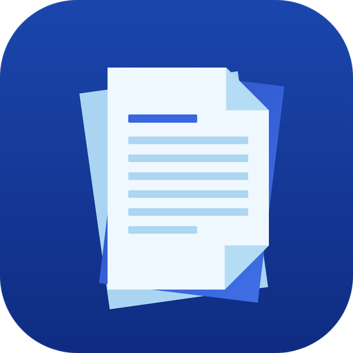
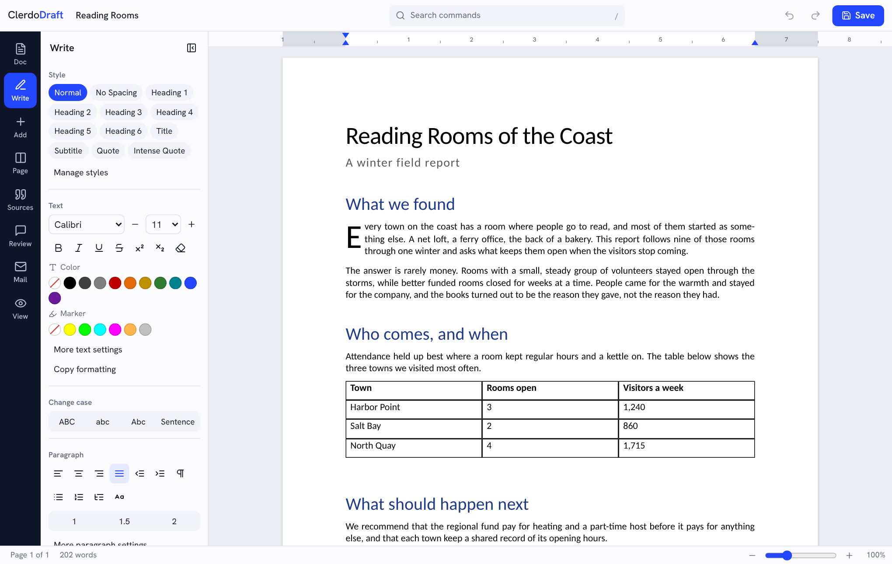
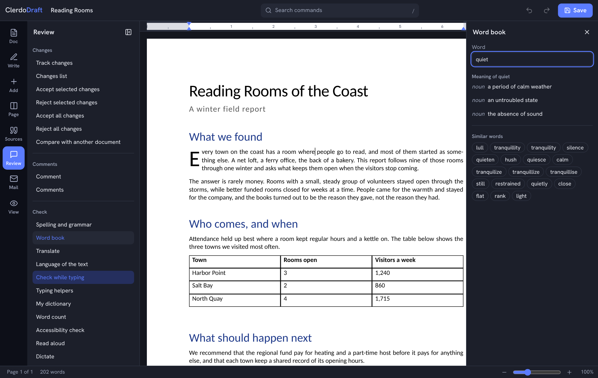
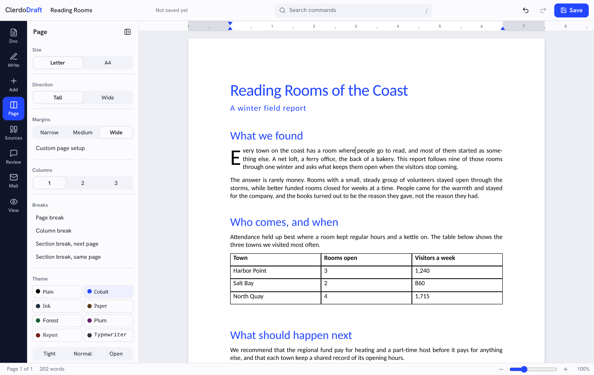
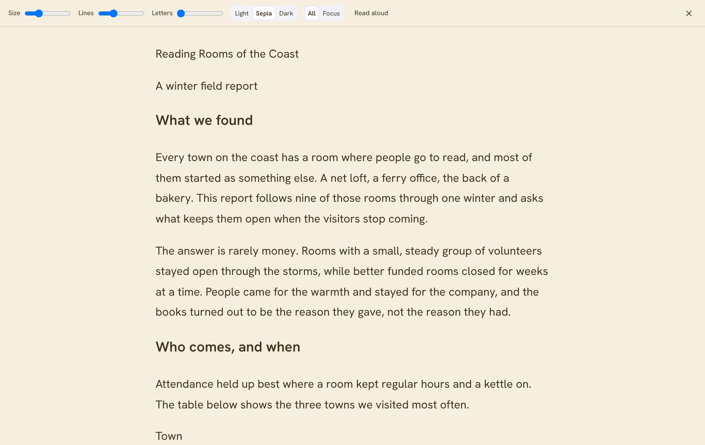
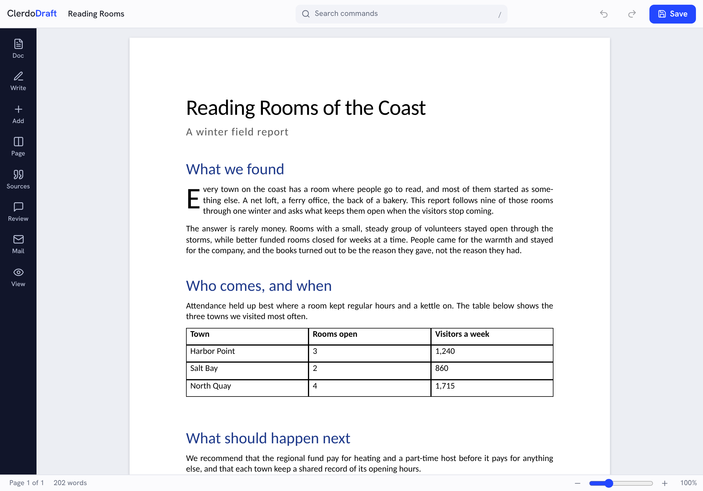

<p align="center"></p>

<h1 align="center">ClerdoDraft</h1>

<p align="center"><strong>A free, open-source word processor by Clerdo.</strong><br>
Write, review and lay out real documents, with your files staying on your own device.<br>Windows, macOS, Linux, iPad and the web.</p>

<p align="center">
<a href="https://clerdo.app">Website</a> ·
<a href="https://github.com/clerdoapp/clerdodraft/releases/latest">Download</a> ·
<a href="https://clerdoapp.github.io/clerdodraft/">Open in your browser</a> ·
<a href="LICENSE-MIT">MIT</a> / <a href="LICENSE-APACHE">Apache-2.0</a>
</p>



## What it does

- **Write:** more than 400 fonts plus every font on your computer, styles, lists, tabs, indents, large first letters, text art with glow, reflection and gradients, right-to-left paragraphs, autocorrect and smart typing. The interface is in English and Arabic.
- **Lay out:** true page layout with sections, columns, headers, footers, footnotes, facing pages, watermarks, page borders, line numbers, automatic hyphens and document themes.
- **Add:** tables with formulas, pictures with crop and adjustments, 20 chart kinds, 52 diagram layouts, about 150 shapes, 2,300 icons, embedded files of any kind, text boxes, drawn equations, pen drawings, online video and audio links, screenshots, fill-in fields, symbols and emoji.
- **Cite:** contents, captions, cross-references, an index, a table of authorities, sources and bibliographies in APA, MLA, Chicago, Harvard and IEEE.
- **Review:** tracked changes including formatting, comments with replies, reactions and filters, document compare, version history, restricted editing, digital signatures, spelling in seven languages and grammar, a built-in word book with meanings and similar words, read aloud and dictation.
- **Mail:** merge from spreadsheets, contacts or data files with rules and a live preview, envelopes and label sheets.
- **Together:** work on one document live, device to device, with no server, or share a document as a link.
- **Read:** page, web, draft and reading views, a focus reader, split view, dark mode and an outline.
- **Files:** opens and saves `.docx`, including password-protected files, and keeps content it doesn't understand instead of dropping it. Also opens `.doc`, `.odt`, `.rtf`, `.pdf`, `.md`, `.html` and `.txt`, and exports `.odt`, `.rtf`, `.pdf`, `.html`, `.md` and `.txt`.
- **Start fast:** 41 templates for letters, résumés, business, school and more.
- **Private:** no account, no server, no tracking. Spelling and the word book work offline.

The full list, with what is finished and what is basic, is in [docs/FEATURES.md](docs/FEATURES.md).

| Dark mode and word book | Themes | Focus reader |
|---|---|---|
|  |  |  |



## Download

Get the latest build from the [Releases page](https://github.com/clerdoapp/clerdodraft/releases/latest):

| System | File |
|---|---|
| Windows | `.msi` installer, or the portable `.exe` / `.zip` |
| macOS | `.dmg` (Apple Silicon and Intel) |
| Linux | `.AppImage` (any distro), `.deb` (Ubuntu, Debian, Mint), `.rpm` (Fedora, openSUSE) or `.tar.gz` |
| iPad and web | Open [clerdoapp.github.io/clerdodraft](https://clerdoapp.github.io/clerdodraft/) in Safari, then **Share > Add to Home Screen** |

The builds aren't code-signed yet:

- **Windows:** in the SmartScreen warning, click **More info**, then **Run anyway**.
- **macOS:** right-click the app, choose **Open**, then **Open** again.
- **Linux AppImage:** make it executable first (`chmod +x`).

## Status

ClerdoDraft is in **alpha**. Everyday writing, review and layout work, and some advanced features are still missing or basic:

- live co-editing and share links;
- digital signatures;
- embedded objects;
- an Arabic spelling dictionary.

[ROADMAP.md](ROADMAP.md) and [docs/gaps.md](docs/gaps.md) track what's next.

## Build from source

You need [Node.js](https://nodejs.org) 22 or newer.

```bash
npm ci
npm run dev        # web app during development
npm test           # unit and file-format tests
npm run e2e        # browser tests (needs Playwright)
npm run dist       # desktop installers for this system
```

Installers are built by GitHub Actions: push a tag such as `v0.5.0` that matches `package.json`, and [release.yml](.github/workflows/release.yml) builds every platform and publishes a release. Every push to `main` publishes the web app. **Check for updates** in the app follows the releases of the repository a build was made from.

More: [docs/development.md](docs/development.md) · [docs/architecture.md](docs/architecture.md) · [docs/file-formats.md](docs/file-formats.md)

## Contributing

Bug reports and ideas are welcome in [Issues](https://github.com/clerdoapp/clerdodraft/issues), and pull requests too. Two rules:

- Nothing may be copied from other companies' software, files, text, icons or artwork.
- No GPL or AGPL code.

[CONTRIBUTING.md](CONTRIBUTING.md) and [AGENTS.md](AGENTS.md) have the full contributor rules.

## License

ClerdoDraft is licensed under either the [MIT License](LICENSE-MIT) or the [Apache License 2.0](LICENSE-APACHE), at your option. Third-party material and its licences are listed in [NOTICE](NOTICE) and [ASSETS.md](ASSETS.md).
